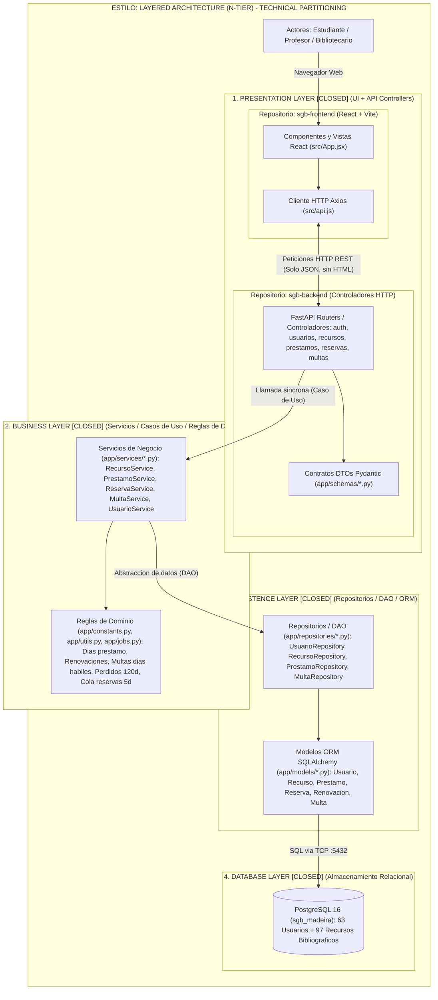

# Arquitectura de Software – SGB Universidad de Madeira

## Segundo Momento Evaluativo: Layered Architecture (N-Tier)
Basado en el libro ***Fundamentals of Software Architecture*** (Mark Richards & Neal Ford, Cap. 10: *Layered Architecture Style*):

- **Estilo Arquitectónico:** Layered Architecture (N-Tier) con **Particionamiento Técnico (*Technical Partitioning*)**.
- **Topología y Aislamiento (*Layers of Isolation*):** Todas las capas están marcadas como **`[CLOSED]` (Capas Cerradas)**. Ninguna capa puede saltarse a otra (el Frontend jamás se conecta directamente a PostgreSQL; toda petición atraviesa estrictamente `Presentation Layer -> Business Layer -> Persistence Layer -> Database Layer`).
- **Protocolo de Comunicación:** El cliente (React SPA) y el servidor (FastAPI) se comunican exclusivamente mediante **peticiones HTTP REST transmitiendo y recibiendo JSON** (el servidor nunca devuelve HTML).

## Diagrama de Arquitectura 100% en Mermaid (Fundamentals of Software Architecture)

